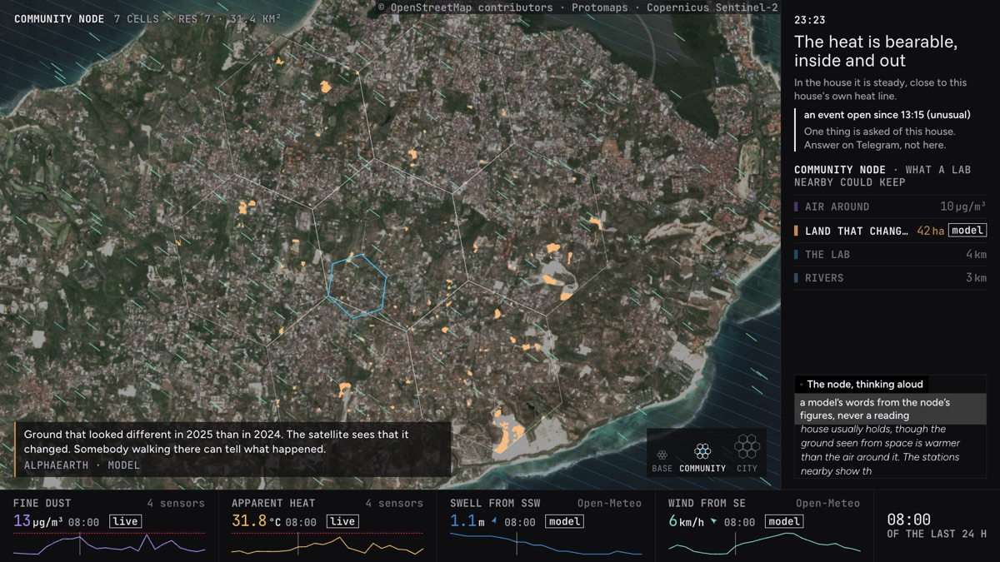

# Wall mode
<!-- checked: v0.92.0 -->

The Wall is the node on a screen in a living room or a lab, read from about three metres by people who know nothing
about air science, and operated by nobody. It is a satellite map that walks out from the house, through the three
sizes a node can have, with the day replayed on it and the wind and the swell moving across it. Beside the map it
says what is asked of the house and what the node's model makes of it. It asks nothing itself. Somebody answers on
Telegram, over the radio or on the dashboard, where they can write.

```
http://<node>:8080/#wall
```

## Putting one up

1. **Let the house read the node.** A wall screen carries no token, so it needs `SHARE_LEVEL=open`:
   `planetai config set SHARE_LEVEL open`, or Set up › Sharing. At `off` the Wall draws one line, "This screen needs
   sharing turned on.", and asks for no token.
2. **Open `/#wall` on the screen.** You should see, in the dark register and inside one viewport, the map on the
   left, a column on the right with the time, the node's sentence and the size on the map, and a strip of four
   readings under both. The bar and the foot of the other doors are gone.
3. **Leave it.** The map spends one replayed day at each size, 30 seconds, an hour every 1.25 s, so the whole walk
   takes a minute and a half and then starts again at the house. With reduced motion on nothing moves, and the Wall
   holds the base size at the last hour with the wind and the crests drawn still.
4. **Reload it now and then.** The Wall reads the node when the page opens.

The map needs MapLibre and WebGL. A screen without them still draws the column and the strip, and says "This screen
cannot draw the map." where the map would be. The column and the strip are drawn before the node answers for the map.
When the node sends nothing for the map (it has no place yet, or the read failed), the line is "The node sent no
map.", and the Wall asks again after 30 seconds, then a minute, then twice as long each time up to five minutes, and
draws the map once it comes. If the screen loses its graphics, the map is drawn again at the next replayed hour. With
reduced motion on there is no next hour, so it comes back when the window changes size or the Wall is opened again.

> **Gap in v0.92.0.** Once it has its map, the Wall does not re-read the node while it stays open, so its figures are
> those of the moment it was opened, and only the narration is new every ten minutes. Reload the screen, or put the
> classic wall up instead, which re-reads on `POLL_SECONDS`.

## What it shows



Nothing on the Wall is smaller than 20 px at 1920×1080, and the type scales with the screen. The one exception is the
size legend at the bottom right of the map, at 16 px. On a phone or a portrait screen the floor never drops under
12 px, and the size legend is hidden there, because it would sit under the chapter's words. The Wall reads in this
order:

- **The map**, most of the screen. Satellite imagery where the node holds it (`/ground/imagery`), dimmed so the
  layers read over it, and where it does not, the node's own streets, dark. Over the map, at the top left, the size
  on screen with its cells, resolution and area; at the bottom left the words of the chapter on screen, where its
  figure comes from and its provenance word; at the bottom right the three sizes as three small clusters of
  hexagons, the one on screen lit. The map credit is at the top right.
- **The time and the sentence**, at the top of the column. The sentence is the headline issue's title as the node
  writes it, and under it is what is asked now, in the node's own sentence with how many things are asked of the
  house and "Answer on Telegram, not here.", or "Nothing is asked now." When the node's last poll is more than 15
  minutes old, the time says the readings are old.
- **The size**, its name and a row for each of its chapters, a title and a figure. The chapter on the map is lit and
  carries its provenance word. A size with nothing yet says "The node holds nothing at this size yet." and keeps its
  cells on the map.
- **The node, thinking aloud**, in its own box under the size, only once there is text.
- **The strip**, under the map and the column: fine dust, apparent heat, the swell and the wind at the replayed hour,
  each with its unit, its hour, its provenance word and where it comes from, and its last 24 hours as a thin line
  with the hour marked and the red line where the reading has one. The swell and the wind have a needle that points
  where they go and say where they come from ("swell from SW"). At the end, the replayed hour. A reading the node
  does not have says so.

The back button and a note naming the model are chrome: hidden until a pointer is over them or the keyboard reaches
them, and always shown as 44 px targets on a touch screen. On a phone, a portrait screen or a small TV everything
stacks: the map first, at about 60 % of the height, then the column, then the strip as two rows of two.

## The three sizes

Each size is a cell and the six touching it, one resolution coarser than the size before.

| size | cells | on node #1 |
|---|---|---|
| base node | the house's resolution-8 cell and the six touching it | 4.5 km², about 2.5 km across |
| community node | the house's resolution-7 cell and the six touching it | 31.4 km², about 7 km across |
| city node | the house's resolution-6 cell and the six touching it | 219.4 km², about 18 km across |

The cells of the size on screen are drawn as a hairline, the smaller sizes inside them fainter, and the house's own
cell is the only one in blue. Each size holds one replayed day, split evenly between its chapters, and each chapter
turns one thing on over the map. A chapter is only there when the node holds what it draws, so a node with fewer
packs has fewer chapters.

| size | chapter | what the map shows | from |
|---|---|---|---|
| base | Air | the house's fine dust, its cell filled, red in any hour over the line | the air issue |
| base | Buildings | the roofs OpenStreetMap has, everything outside the circle they are counted in dimmed, and how much of the ground is built on; with no street tiles on the node, neither this nor Sun today is shown | the place pack, the land issue |
| base | Sun today | the same roofs in the energy colour, the sun on each square metre today, and what the house's panel size would make with it | the energy pack |
| base | Ground heat | the cell at the last clear Landsat pass, against the land 1 to 3 km around | the heat issue |
| base | Rain | the rain forecast for the next 24 hours, and how much ground drains through the cell | the terrain pack |
| community | Air around | the outdoor stations the node reads, a dot each at the replayed hour, red over the line and grey when it read nothing | the station packs |
| community | Land that changed | the ground that looked different from one year to the next, in the community's whole cells | the earth pack, after `planetai run earth change`; a node that has moved reads its square again first, `planetai run earth fetch --force` |
| community | The lab | the nearest fab lab, ringed, and how far it is | the make pack |
| community | Rivers | the rivers around, and the nearest one's flow | the hydro pack |
| city | Fossil power | at least how much of the grid's power is burnt fuel, and the nearest plant of 100 MW or more within 30 km, with a dotted line to it from the middle of the house's cell | the energy pack |
| city | The basin | all the ground that drains to the sea with the house, and the largest river nearby | the hydro pack |
| city | Swell | the crests on the sea at full strength | Open-Meteo's marine model |
| city | City air | the stations across the island as they read now, the government's ringed and named | the bali-air-dispatch pack |

The island's stations have no day on the node, so they do not replay, and they are left off once the list is more
than three hours old.

The camera glides to a new size in 2.6 s, and widens in 1.6 s when a chapter draws something outside the cells, such
as the plant or the basin. Nothing else on the Wall glides. The figures step from hour to hour and do not count up.
While the camera glides the crests on the sea are off, and they fade back in when it stops.

## Wind and swell

Everything that moves on the map is a reading at the replayed hour, from the node's own Open-Meteo rows.

The wind is about 260 short streaks over the whole map, moving where the wind goes and faster the stronger it is,
each fading in and out over four seconds. The swell is a set of crest lines on the sea only, square to where the
waves go, 26 px apart, one crest passing for every swell period in real seconds, and thicker the higher the swell.
The crests are faint at every size and strong in the Swell chapter. The sea is the water in the node's own street
tiles, so a node without them draws no crests.

When an hour has no row, the motion takes the nearest hour that has one. When the day has no direction, speed,
height or period at all, that motion is left off. Under reduced motion both are drawn still.

## The node, thinking aloud

Every ten minutes the Wall asks `POST /ask` with `prompt: wall`, so the model is the one chosen in Set up › Model
(`AGENT_PREFER`). The node tells it to speak like a calm neighbour in six to eight plain sentences: what is happening
inside, how it compares with the street and the neighbourhood, what it suggests for an ordinary day, and what the next
hours may bring, with no units, at most two numbers, and never saying that anything is safe. The model is offered no
tools, since every fact it may use is in the request, so it answers without thinking first. That takes a few seconds on
node #1's remote model, where thinking had taken more than four minutes and the box stayed empty. The Wall types the
text at a reading pace. A story taller than its box then rolls up, a line every three seconds, in a loop that brings its
start round again; under reduced motion it stands still at its start. The last text stays up while the next is written,
held in the page's memory and never stored. The box says these are a model's words from the node's figures, and "written
online" when the keeper's choice sent the question out. With no model on the node, or `UI_ASK=off`, there is no box.

The node gives the model only public facts, each a short labelled line with its unit and where it comes from (`live`,
`model` or `satellite`): the time of day; each watched issue's day sentence, its values inside the home, on the
street, in the neighbourhood and in the wider area, its line and its trend; every issue's readouts, such as the land's
built and tree share and the sea's swell; how many public stations nearby read fine dust and how many are over the WHO
line; what is usual for the place (from the outdoor sensors only); the next six hours of forecast; and
every section a pack declares with `wall: true`. Each narration starts from an angle those facts can carry (the day so
far, the stations around, what is usual here, the next hours, the land and the sea, fires, the ground's heat), and an
angle with no facts is skipped.

## What the Wall never shows

Anyone in the room reads the Wall, so it names no sensor, room, kit or person, and the model's facts carry none of
them either. What is asked is the node's own sentence. The alert's text can name a room, so the Wall leaves it out.
It does not show what the house learned, its diary, its things or a button to answer, and nothing on it is placed
finer than the house's cell.

The map is read without a token, from `GET /wall`, so the node coarsens it before it leaves. The house is always its
resolution-8 cell. Every distance is in whole kilometres from the middle of that cell, and the line to a power plant
starts there too. Only public places have a point on the map, at three decimals. The stations are the ones the
station packs read, and a radio or the house's own kit away from home is not one of them. A station near the house
is left out wherever in the cell the house stands, so a missing dot does not give the house away. The roofs
are counted within a circle round the middle of the cell, its radius rounded down to whole 100 m. The land that changed is cut to the community's whole
cells, and the earth pack's square round the house is not used for it. The place pack's satellite-only roofs stop
in a circle round the house, so they are not drawn. The only names on the map are public places, such as the
government's station or the nearest lab. It is always dark, whatever register the other doors are in.

## The classic wall

`/?layout=classic#wall` opens the classic dashboard's wall, which re-reads the node on `POLL_SECONDS` like every
classic view. The line `planetai ui` prints for a wall screen (add `#wall`, it moves its own ladder, it needs
`SHARE_LEVEL=open`) describes this one, although on `/` the same `#wall` opens the doors' Wall. At `off` it draws the
refused page in the dark register, with the node's own sentence.

**The top bar**, from the left: a **back** button, first in keyboard order; up to four metric chips (the one shown
first, then the node's order, and "+N more" for `?vars=all`; `?var=` picks one, default `pm25`); the node's name, its
city, `#wall`, a share level, and "the ladder moves every 8 s" or, under reduced motion, "the ladder stands still";
and at the right the variable, its unit and `15-min means`.

**The grid.** Nineteen H3 cells, the node's own and two rings around it, at the current resolution, with no map under
them. A cell with one station holds its 15-minute mean and its name; with several, how many and the range; the node's
own cell, each of its own stations. An empty cell is drawn and left empty.

**The ladder** is drawn as hexagons: the current rung filled ink, a rung whose cell may leave the machine filled in the
cells blue at 0.16, a rung finer than the published resolution dashed. Every eight seconds it steps to the next rung
and the grid re-draws, with no tween between rungs. Pressing a rung or a cell, or an arrow key, holds it for thirty
seconds. Under `prefers-reduced-motion: reduce` nothing moves.

**The right column** has the headline issue (kicker, title, tagline, why and the alert), then "Answer on Telegram, not
here.", the ladder with its key, the counts (cells with a station, stations in the node's cell, and of them its own),
and the ρ row. The ρ row counts rings and never sizes them: one ring per alert up to 40, one per 10 up to 400, then one
per 100, with the unit and the exact counts under it. Under the grid, the first five fragments the sections contribute
through `wall()`, then "+N more in Now". The classic wall shows open alerts, not alert events, so on a node whose
engine is `shadow` or `events` it can read "Nothing has been asked." while Decide has an event open.

**The foot** has the as-of time, the version and the motion caption. When a poll got no answer the as-of time reads
"Read at … · the node has not answered for N min". If the wall throws while it draws, it says "The wall did not
render:" and why, rather than going black.

> **Gap in v0.92.0.** On the classic wall the share level in the top bar always reads `off`, because `/health`
> carries no share level, and the bold `stale` in the foot is a fixed label that shows whether or not the node is
> answering. The as-of time beside it is the one to read.

## Where this leads

Whatever the Wall shows as asked is answered on Telegram, over the radio or on the dashboard, and each of them writes
the same row in `actions`: see [Channels](channels.md) and [the dashboard](dashboard.md). What the map reads is
[`GET /wall`](api.md#get-wall), what the classic wall's ρ row counts is [ρ](rho.md), and how the Wall is drawn is
[Design](design.md).
